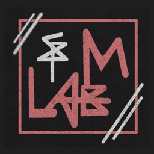
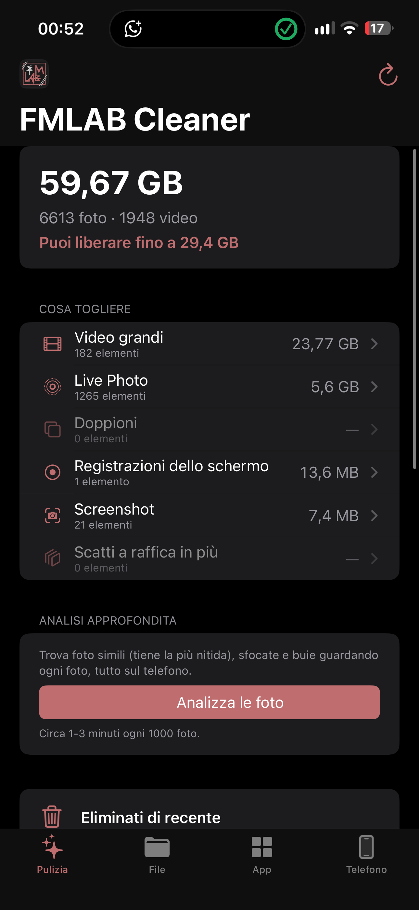
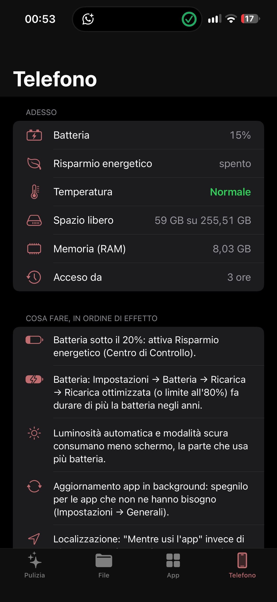

# FMLAB Cleaner 🧹📱

[🇮🇹 Italiano](README.md) · 🇬🇧 English

**FMLAB Cleaner** is an iPhone app that frees up space safely and shows the phone's real status.
Everything stays on the phone: no internet (except the update check), no subscriptions, no ads.
The app follows the iPhone language (Italian or English).

  
  

## Install

1. Open **LiveContainer** → **+** → **Install from URL** and paste:
   `https://github.com/cipherdesk007-max/FMLAB-cleaner/releases/download/ultima/FMLAB-Cleaner.ipa`
2. On first launch allow **Full Access** to Photos (the prompt shows LiveContainer's name).

Updates are announced inside the app: **Copy install link**, then in LiveContainer + → Install from URL → Paste.
It installs over the old version and keeps your data. Works with SideStore/AltStore as a normal app too.

## What it does

| Tab | What it does |
|---|---|
| **Clean** | Large videos (largest first; remove or **compress** to about half), **Live Photo → photo** (drops the 3-second video), identical duplicates (the original stays), screen recordings, screenshots, unpicked burst shots. **Empty "Recently Deleted"** in one go |
| **Apps** | Only inside LiveContainer: space used by each hosted app, clear caches and temp files, remove leftover .ipa files and data of uninstalled apps |
| **Phone** | Battery, Low Power Mode, thermal state as reported by iOS, storage, memory, uptime, tips ordered by impact |

**Safety**: nothing is deleted without your choice; iOS always asks to confirm and photos/videos go to
*Recently Deleted* (30 days). The Apps tab only removes caches, temp files, .ipa files and orphaned data, never
documents or data of installed apps.

**What no iPhone app can do** (apps that promise it do nothing real): free RAM, close other apps, "repair" the
battery, delete iOS files or files of apps outside LiveContainer.

## How it's built

- SwiftUI + PhotoKit, iOS 15+, Italian and English. Sources in [`Sorgenti/`](Sorgenti/).
- FMLAB colors: red `#BF6D6F` (from the logo) on black.
- Built by GitHub Actions on Linux with [Theos](https://github.com/theos/theos) (no Mac needed): every change on
  `main` publishes a numbered release and the **ultima** (latest) release the app updates from.
- History: [CHANGELOG.md](CHANGELOG.md). License: [MIT](LICENSE).

Part of the FMLAB family with [FMlab - RunnerKit](https://github.com/cipherdesk007-max/FMlab---RunnerKit)
(Linux on iPhone with LinuxRunner).
