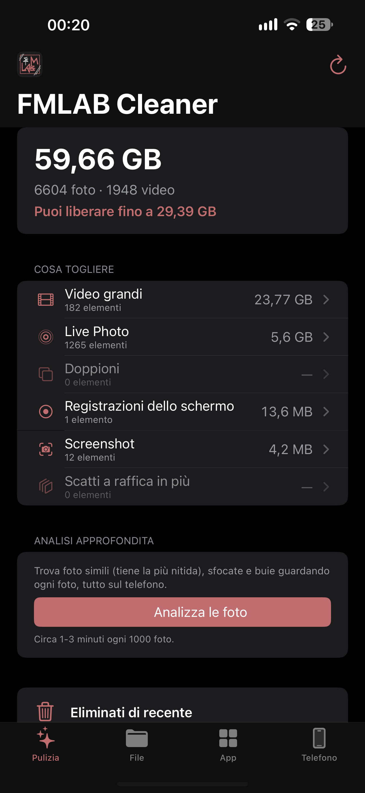
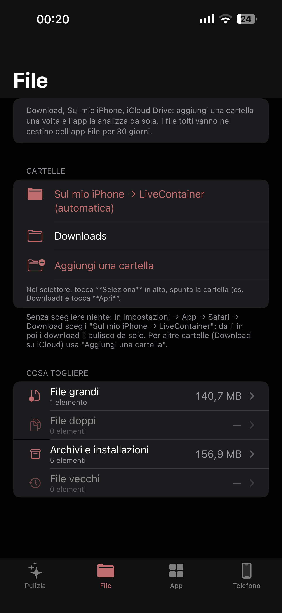
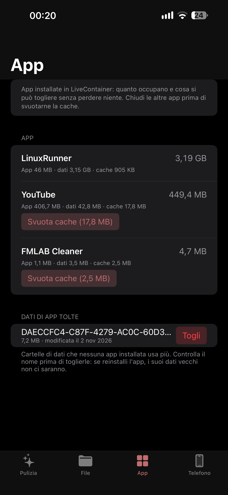
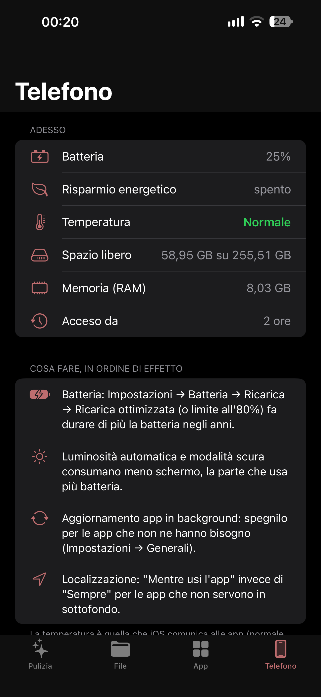

# FMLAB Cleaner 🧹📱

🇮🇹 Italiano · [🇬🇧 English](README.en.md)

**FMLAB Cleaner** è un'app per iPhone che libera spazio in sicurezza e mostra lo stato vero del telefono.
Tutto resta sul telefono: niente internet (tranne il controllo aggiornamenti), niente abbonamenti, niente pubblicità.

  
  
  
  

Le schermate di FMLAB Cleaner 1.8.3 (ultima versione prima delle correzioni estetiche) sono anche in [`screenshots/1.8.3/`](screenshots/1.8.3/).

## Installazione

1. Apri **LiveContainer** → **+** → **Installa dall'URL** e incolla:
   `https://github.com/cipherdesk007-max/FMLAB-cleaner/releases/download/ultima/FMLAB-Cleaner.ipa`
2. Al primo avvio consenti l'accesso a **Tutte le foto** (la richiesta compare a nome di LiveContainer).

Oppure scarica [il file .ipa](https://github.com/cipherdesk007-max/FMLAB-cleaner/releases/download/ultima/FMLAB-Cleaner.ipa)
e installalo con **+ → Installa da IPA** (se la cartella Download è su iCloud e dà "Errore", usa il link).

Gli aggiornamenti li segnala l'app stessa: **Copia link di installazione**, poi in LiveContainer + → Installa
dall'URL → Incolla. Si installa sopra la versione vecchia e i dati restano. Funziona anche con SideStore/AltStore.

## Cosa fa

| Scheda | Cosa fa |
|---|---|
| **Pulizia** | **Foto simili** (resta la più nitida), **sfocate** e **buie** con l'analisi approfondita; video grandi (dal più pesante, da togliere o **comprimere** a metà peso), **Live Photo → foto** (via il video di 3 secondi), doppioni identici (l'originale resta), registrazioni dello schermo, screenshot, scatti a raffica non scelti. **Svuota "Eliminati di recente"** tutto in una volta |
| **File** | Cartelle dell'app File scelte da te (Download, Sul mio iPhone, iCloud Drive): file grandi, doppi (verificati), archivi e installazioni, file vecchi. Tutto va nel cestino di File (30 giorni). Dentro LiveContainer la cartella "Sul mio iPhone → LiveContainer" si pulisce da sola e il selettore di cartelle funziona senza impostazioni da cambiare |
| **App** | Solo dentro LiveContainer: quanto occupa ogni app ospitata, svuota cache e file temporanei, toglie i file .ipa rimasti e i dati di app già disinstallate |
| **Telefono** | Batteria, risparmio energetico, temperatura come la comunica iOS, spazio, memoria, da quanto è acceso, consigli in ordine di effetto |

**Sicurezza**: niente si cancella senza la tua scelta; iOS chiede sempre conferma e foto e video vanno in
*Eliminati di recente* (30 giorni). Nella scheda App si tolgono solo cache, temporanei, .ipa e dati orfani, mai
documenti o dati delle app installate.

**Cosa nessuna app per iPhone può fare** (e chi lo promette non fa niente di vero): liberare la RAM, chiudere le
altre app, "riparare" la batteria, cancellare file di iOS o di app fuori da LiveContainer.

## Privacy

Le foto non escono mai dal telefono: l'analisi, la compressione e la conversione avvengono sull'iPhone.
L'unica connessione è il controllo aggiornamenti, che legge un numero di versione da GitHub. Niente
pubblicità, niente statistiche, niente account.

## Come è fatta

- SwiftUI + PhotoKit, iOS 15 o successivo, italiano e inglese. Sorgenti in [`Sorgenti/`](Sorgenti/).
- Colori FMLAB: rosso `#BF6D6F` (dal logo) su nero.
- Compilata da GitHub Actions su Linux con [Theos](https://github.com/theos/theos) (nessun Mac necessario):
  a ogni modifica su `main` esce una versione numerata e la pubblicazione **ultima**, da cui l'app si aggiorna.
- `project.yml` serve per aprirla in Xcode con XcodeGen, se un giorno si usa un Mac.
- Storico: [CHANGELOG.md](CHANGELOG.md). Licenza: [MIT](LICENSE).

Parte del mondo FMLAB, insieme a [FMlab - RunnerKit](https://github.com/cipherdesk007-max/FMlab---RunnerKit)
(Linux sull'iPhone con LinuxRunner).
